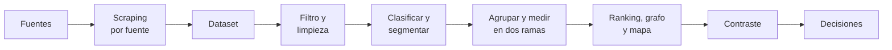
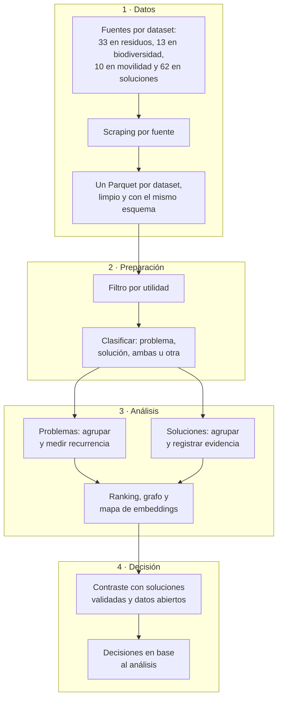

<div align="center">

# pipeline-decision-data

**Saber qué problemas se repiten antes de elegir cuál resolver.**

Pipeline de análisis de problemáticas · Hack to the Future · Córdoba Tech Week 2026

[](https://www.python.org/)
[](https://pandas.pydata.org/)
[](https://arrow.apache.org/docs/python/)
[](https://requests.readthedocs.io/)

**Ignacio, Lauti y Diego**

</div>

---

Hack to the Future plantea cuatro temáticas de sostenibilidad, y el equipo tiene que elegir qué problema
abordar. Nadie del equipo tiene experiencia directa con residuos, el primer track que va a analizar.

Este proyecto busca reunir miles de notas periodísticas, ordenarlas por problema y mostrar cuáles se
repiten. El objetivo es descubrir alguno que el equipo no conocía y usar esa información como punto 0
para elegir la problemática y plantear el producto.

```text
Formato de ejemplo, sin datos reales:

Problema:             <nombre del problema>
Track:                Residuos
Notas y hechos:       <cantidad de notas> · <hechos distintos>
Medios:               <medios independientes>
Tiempo:               <años en que aparece> · <continuidad> · <tendencia>
Lugares:              <ciudades, provincias o países>
Actores:              <actores afectados> · <origen de la voz>
Magnitud:             <cifras informadas en las notas>
Soluciones fallidas:  <planes o anuncios previos>
```

> [!IMPORTANT]
> **Los datos orientan. El equipo decide.** Los resultados ayudan a elegir, pero no prueban por sí solos
> que un problema importe. Las noticias muestran lo que se publica, no todo lo que pasa.

> [!NOTE]
> **Estado actual:** al 8/11/2026 los datasets están descargados, limpios y deduplicados, en un Parquet por
> dataset: 40.232 notas de residuos, 33.620 de problemáticas de biodiversidad, 53.029 de problemáticas de
> movilidad y 19.817 de soluciones tecnológicas en los cuatro tracks. Sus pros y contras están en el
> [análisis de residuos](docs/analisis-datasets/analisis-dataset-residuos.md), el [de soluciones](docs/analisis-datasets/analisis-dataset-soluciones.md),
> el [de biodiversidad](docs/analisis-datasets/analisis-dataset-biodiversidad.md) y el [de movilidad](docs/analisis-datasets/analisis-dataset-movilidad.md).
> Falta medir cuántas notas son útiles. Todavía no hay clasificación ni análisis.

---

## Por qué este proyecto

La idea surge del video "Idea Plotter", de @re_skob, basado en una receta de Synthetic Beef. Ahí
convierten 189.495 juegos de Steam en un mapa de significado para encontrar zonas vacías. El equipo
quiere llevar ese enfoque a problemas reales, aunque no necesariamente con el mismo método.

El pipeline busca:

1. **Reunir** noticias de medios locales, nacionales e internacionales.
2. **Ordenar** cada nota con título, fuente, cuerpo y fecha.
3. **Clasificar y segmentar** el contenido según el problema que describe.
4. **Medir** cuánto se repite cada problema, dónde y durante cuánto tiempo.
5. **Decidir** qué problemática abordar a partir de ese análisis.

---

## De las notas a la decisión



### Medidas de recurrencia

| Grupo | Pregunta que responde | Medidas |
|---|---|---|
| **Volumen** | ¿Cuánto se habla del problema? | Cantidad de notas · hechos distintos · medios independientes |
| **Tiempo** | ¿Persiste o fue un pico? | Años en que aparece · continuidad · tendencia |
| **Alcance** | ¿A quién y dónde afecta? | Lugares afectados · actores afectados · magnitud informada |
| **Respuesta** | ¿Quién lo plantea y qué se intentó? | Soluciones fallidas · origen de la voz |

---

## Alcance objetivo

| Etapa | Qué incluye | Qué tendría que mostrar |
|---|---|---|
| **Residuos** | Hasta 10.000 notas de medios locales y nacionales, y fuentes internacionales desde 2024 | Si el pipeline revela problemas que el equipo no conocía |
| **Biodiversidad, agro y movilidad** | El mismo proceso, con hasta 10.000 notas por track, si hay tiempo | Qué problemas se repiten en cada temática |

Si no llegamos a procesar los otros tres tracks, el análisis de residuos sigue siendo válido.

---

## Arquitectura objetivo

Hoy están construidas las etapas de fuentes, scraping, dataset y limpieza, para residuos, biodiversidad,
movilidad y soluciones. Falta el filtro por utilidad. El resto es el diseño acordado; las dudas abiertas están en
[`docs/pipeline-arquitectura.html`](docs/pipeline-arquitectura.html).



### Criterios de ponderación

- **Geografía:** tienen más peso los problemas locales y los que aparecen en varios países. Faltan los
  valores y definir qué cuenta como local.
- **Fecha:** se guarda para filtrar y comparar, no como peso fijo. Un problema que persiste de 2021 a
  2026 es justo lo que se busca.

### Límites del método

- Un problema frecuente en los diarios no es necesariamente el más grave.
- Lo más recurrente suele ser lo más visible, y eso puede chocar con la búsqueda de algo desconocido.
- Que una solución no aparezca en las noticias no significa que no exista.

---

## Dónde está la evidencia

| Afirmación | Dónde está | Cómo revisarla |
|---|---|---|
| Objetivo, decisiones y dudas abiertas | [`docs/analisis-datasets/contexto-pipeline.md`](docs/analisis-datasets/contexto-pipeline.md) | Leer las secciones de decisiones y "Falta aclarar" |
| Diseño del pipeline | [`docs/pipeline-arquitectura.html`](docs/pipeline-arquitectura.html) | Abrir el boceto y la lista "Por definir" |
| Hay 43 fuentes posibles, con su acceso revisado | [`docs/analisis-fuentes/Fuentes para el dataset del pipeline.md`](docs/analisis-fuentes/Fuentes%20para%20el%20dataset%20del%20pipeline.md) | Comparar cada fila con el `robots.txt` del medio |
| Hay 4 datasets limpios y deduplicados, con ruido de tema sin filtrar | Análisis de [residuos](docs/analisis-datasets/analisis-dataset-residuos.md), [biodiversidad](docs/analisis-datasets/analisis-dataset-biodiversidad.md), [movilidad](docs/analisis-datasets/analisis-dataset-movilidad.md) y [soluciones](docs/analisis-datasets/analisis-dataset-soluciones.md), y [`data/`](data/) | Leer el análisis y recontar los Parquet; los títulos permiten repetir la lectura de muestra |
| Cómo se limpió y qué se descartó | [`contexto-pipeline.md`](docs/analisis-datasets/contexto-pipeline.md#limpieza-y-consolidación-8112026) y [`scripts/limpiar.py`](scripts/limpiar.py) | Correr `python scripts/limpiar.py --selfcheck` y leer la tabla de descartes |
| Cada fuente se lista por una vía que su `robots.txt` no excluye | [`docs/scrapping-webs.md`](docs/scrapping-webs.md) y [`scripts/`](scripts/) | Comparar la sección "Permisos" de cada fuente con su `robots.txt` |
| Datos del evento y reglas confirmadas | [`CLAUDE.md`](CLAUDE.md) | Comparar con la [fuente oficial](https://cordobatechweek.com/side-events/hack-to-the-future/) y lo informado por la organización |

---

## Estado del repositorio

| Área | Estado |
|---|---|
| Contexto y decisiones | **Documentado** |
| Boceto de la arquitectura | **Digitalizado**, con dudas abiertas |
| Relevamiento de fuentes | **Inicial:** falta revisar términos de uso y foros |
| Medición del volumen | **Parcial:** hay conteos por fuente y track; falta medir utilidad y notas reescritas entre medios |
| Scraping | **Completo por ahora:** 33 fuentes en residuos, 13 en biodiversidad, 10 en movilidad y 62 en soluciones. Infobae y Clarín bajaron solo lo prioritario. Futuro Sustentable no tiene datos; Cadena 3 quedó de lado por falta de volumen |
| Dataset | **Limpio y consolidado (8/11):** un Parquet por dataset, con el mismo esquema: residuos 40.232 notas, biodiversidad 33.620, movilidad 53.029 y soluciones 19.817 con su columna `tracks`. Falta filtrar por utilidad |
| Limpieza | **Hecha:** [`limpiar.py`](scripts/limpiar.py) quitó pies de suscripción, notas sin cuerpo, títulos seriados y duplicados por `id`, título y cuerpo. Se eliminaron las señales de problema y de opinión, poco precisas. El circuito de problemáticas está en [`docs/circuito-problematicas.md`](docs/circuito-problematicas.md) |
| CI de Python | **Implementado:** en cada PR corre lint de errores graves, el límite de 100 MB por Parquet y los tests de [`scripts/clasificacion/`](scripts/clasificacion). El test de integración se omite si falta la muestra local. Lean no iniciado |
| Clasificación y segmentación | **No iniciado** |
| Grafo y análisis | **No iniciado** |

---

## Ejecutar localmente

Requiere Python con `requests`, `pandas` y `pyarrow`. Los comandos de cada fuente están en
[`docs/scrapping-webs.md`](docs/scrapping-webs.md). Por ejemplo:

```bash
python scripts/scrape_internacional.py
```

Para verificar el código sin descargar nada:

```bash
python scripts/scrape_infobae.py --selfcheck
```

Para limpiar y consolidar después de una descarga (los Parquet por fuente tienen que estar en `data/`):

```bash
python scripts/limpiar.py --simular
python scripts/limpiar.py
```

Para correr los mismos chequeos que el CI (requiere `pip install -r requirements-ci.txt`):

```bash
ruff check --select E9,F63,F7,F82 scripts
pytest scripts/clasificacion -v
```

Para leer un dataset:

```python
import pandas as pd
notas = pd.read_parquet("data/soluciones.parquet")
notas[notas["tracks"].map(lambda t: "agro" in t)]
```

---

## Mapa del repositorio

```text
.
├── data/
│   ├── biodiversidad.parquet                        Problemas de biodiversidad, limpios
│   ├── movilidad.parquet                            Problemas de movilidad sustentable, limpios
│   ├── residuos.parquet                             Notas de residuos, limpias
│   ├── soluciones.parquet                           Soluciones de los cuatro tracks, con la columna tracks
│   └── soluciones/crudo/                            Descarga cruda de soluciones, fuera de Git
├── docs/
│   ├── analisis-datasets/
│   │   ├── analisis-dataset-biodiversidad.md       Pros y contras de las problemáticas de biodiversidad
│   │   ├── analisis-dataset-movilidad.md           Pros y contras de las problemáticas de movilidad
│   │   ├── analisis-dataset-residuos.md            Pros y contras del dataset de residuos
│   │   ├── analisis-dataset-soluciones.md          Pros y contras del dataset de soluciones
│   │   └── contexto-pipeline.md                     Objetivo, decisiones, hechos y dudas abiertas
│   ├── analisis-fuentes/
│   │   ├── Fuentes para el dataset del pipeline.md  Fuentes posibles y su acceso
│   │   └── otras-random/                            Análisis de Croma y resumen de 16 publicaciones
│   ├── circuito-problematicas.md                    Circuito y decisiones del scraping de problemáticas
│   ├── pipeline-arquitectura.html                   Boceto digitalizado del pipeline
│   └── scrapping-webs.md                            Cómo funciona cada script
├── .github/workflows/
│   └── python-ci.yml                                CI de Python en cada PR: lint, límite de 100 MB y tests
├── scripts/                                         Scraping por fuente y limpieza (limpiar.py)
│   ├── clasificacion/                               Pipeline de clasificación y sus tests (test_*.py)
│   └── diccionarios/                                Términos de residuos, soluciones, biodiversidad y movilidad
├── CLAUDE.md                       Datos del evento e indicaciones para Claude
├── requirements-ci.txt             Dependencias mínimas del job de CI
└── README.md                       Presentación del proyecto
```

---

## Principios

1. **Los datos orientan; el equipo decide.**
2. **Lo publicado no es todo lo que pasa.**
3. **La persistencia es una señal.**
4. **Primero medir; después escalar.**
5. **Decir lo que todavía no está comprobado.**

---

## Equipo

| Integrante | Foco |
|---|---|
| **Ignacio** | Idea inicial y diseño del pipeline |
| **Lauti** | Perfil técnico; tareas por definir |
| **Diego** | Perfil técnico; tareas por definir |

Preparado en Córdoba para **Hack to the Future**, la hackathon de innovación sostenible de la
**Córdoba Tech Week**, organizada por **Córdoba Cluster**.

<div align="center">

### pipeline-decision-data

*De noticias dispersas a una decisión informada.*

</div>
