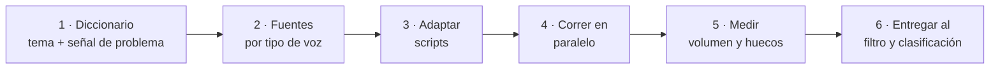

# Circuito de scraping de problemáticas

Borrador del 5/11/2026, actualizado el 6/11. Verticales: biodiversidad y movilidad sustentable.
Falta revisarlo con el equipo.

## Objetivo

Juntar notas, columnas de opinión y voces especializadas que describan **problemas**, no soluciones,
empezando por biodiversidad.

El scraping de residuos buscó todo lo que mencionaba el tema. Este circuito busca otra cosa: textos que
ayuden a responder las 4 preguntas de la cápsula de la organización.

| Pregunta de la cápsula | Qué puede aportar el scraping | Qué no puede aportar |
|---|---|---|
| ¿Por qué pasa? | Causas que mencionan especialistas y notas | Confirmar que esas causas son las reales |
| ¿A quién le pasa? | Actores, lugares y casos concretos | Hablar con esas personas |
| ¿Qué evidencia tenemos? | Datos, cifras y casos publicados | Validarlos: una nota no es prueba |
| ¿Qué no sabemos? | Huecos: temas con poca cobertura o voces que faltan | Las respuestas: eso va a mentores y expertos |

También sirve para dos ítems de "Qué no le puede faltar a tu idea": **problema bien definido**
(causas, a quién, evidencia) e **impacto en Córdoba** (qué pasa acá y no solo afuera).

## El circuito



1. **Diccionario.** Armar las palabras de búsqueda en dos capas (ver abajo). Se armó el borrador y
   Gina lo corrige.
2. **Fuentes.** Elegir fuentes por tipo de voz: diarios, opinión, especialistas y ONG, y política.
   Revisar el `robots.txt` y los términos de uso de cada fuente nueva antes de bajar nada.
3. **Adaptar scripts.** Los scripts estaban fijos en residuos: usan sus palabras y guardan
   `<fuente>_residuos.parquet`. Se resolvió con dos scripts propios que aceptan la vertical (ver Estado).
4. **Correr en paralelo.** Un script por fuente, cada uno en su propia terminal.
5. **Medir.** Contar cuántas notas trae cada fuente y qué tipos de voz faltan. Decidir si hace falta
   sumar fuentes.
6. **Entregar.** El filtro, la clasificación y los patrones son el paso siguiente del pipeline, que
   hacen Ignacio, Lauti y Diego.

## 1 · Diccionario en dos capas

Buscar solo "biodiversidad" trae de todo, incluidas notas de soluciones, eventos y premios. La idea es
combinar dos capas:

- **Tema:** de qué habla la nota.
- **Señal de problema u opinión:** palabras que suelen aparecer cuando se describe un problema o habla
  alguien especializado.

Con la capa de tema se busca en la fuente. La capa de señal se usa para marcar cada nota (`señal_problema`
y `señal_opinion`) y no para descartarla, así no se pierde nada antes del filtro.

> [!NOTE]
> Son palabras de búsqueda, no conclusiones. Hay que sacar o agregar lo que haga falta.

### Biodiversidad: tema (español)

```text
biodiversidad, especies amenazadas, especies en peligro, extinción, fauna silvestre, flora nativa,
bosque nativo, monte nativo, desmonte, deforestación, ley de bosques, humedales, ley de humedales,
incendios forestales, áreas protegidas, reserva natural, parque nacional, especies invasoras,
tráfico de fauna, caza furtiva, polinizadores, pérdida de hábitat, Chaco seco, Sierras de Córdoba,
Ansenuza, Mar Chiquita
```

### Biodiversidad: tema (inglés)

```text
biodiversity, endangered species, extinction, wildlife, deforestation, native forest, wetlands,
wildfires, protected areas, invasive species, wildlife trafficking, poaching, pollinators,
habitat loss
```

### Señal de problema

```text
crisis, conflicto, denuncia, denuncian, reclamo, reclaman, amenaza, pérdida, riesgo, alerta, advierten,
emergencia, falta de, déficit, deterioro, retroceso, incumplimiento, impacto, afectados, desaparición
```

### Señal de opinión o voz especializada

```text
opinión, columna, análisis, entrevista, especialista, investigador, investigadora, experto, experta,
científico, científica, biólogo, bióloga, CONICET, universidad, ONG, legislador, legisladora, proyecto de ley
```

Las otras tres verticales (agro, movilidad y residuos) se arman igual cuando biodiversidad funcione.

## 2 · Fuentes por tipo de voz

### Ya tienen script y sirven para biodiversidad

Solo hay que cambiarles las palabras y la carpeta de salida.

| Fuente | Script | Por qué sirve |
|---|---|---|
| Mongabay (español) | `scrape_mongabay.py` | Especializada en biodiversidad y bosques |
| Mongabay (inglés) | `scrape_internacional.py` | Ídem, internacional |
| Grist | `scrape_internacional.py` | Ambiente y clima, con columnas de opinión |
| Infobae | `scrape_infobae.py` | Nacional, tiene sección de opinión |
| Clarín | `scrape_ldjson.py` | Nacional |
| La Nación | `scrape_ldjson.py` | Nacional, tiene sección de opinión |
| TN | `scrape_tn.py` | Nacional |
| El Doce | `scrape_eldoce.py` | Córdoba |
| CBA24N | `scrape_cba24n.py` | Córdoba |
| Ecoticias | `scrape_especializadas.py` | Ambiente, España |
| CicloVivo | `scrape_especializadas.py` | Ambiente, Brasil |
| Visión Sustentable | `scrape_visionsustentable.py` | Ambiente, Argentina |
| Ecomundo | `scrape_ecomundo.py` | Ambiente |

Las fuentes especializadas solo en residuos o reciclaje, como Resource Recycling o ISWA, no sirven para
biodiversidad.

### Candidatas nuevas (sin revisar)

Ninguna se probó todavía. Antes de usarlas hay que revisar el `robots.txt`, los términos de uso y si tienen
una vía de acceso simple, como una API de WordPress o sitemaps.

| Tipo de voz | Candidatas |
|---|---|
| Opinión | Secciones de opinión de La Nación, Infobae y Clarín. The Conversation (español e inglés), donde escriben investigadores |
| Especialistas y ONG | FARN, Fundación Vida Silvestre Argentina, Aves Argentinas, noticias del CONICET y de la UNC |
| Política | Legislatura de Córdoba, Concejo Deliberante de Córdoba, proyectos en el Congreso de la Nación |
| Internacional | A definir según lo que traigan las primeras corridas |

## 3 · Qué cambia en los datos

Los mismos campos que en residuos, más estos:

| Campo | Valores | Para qué |
|---|---|---|
| `vertical` | biodiversidad, agro, movilidad, residuos | Separar por vertical |
| `tipo_voz` | diario, medio_especializado, opinion, especialista, politica | Saber quién plantea el problema. Es `opinion` si la sección o las etiquetas lo indican |
| `seccion` | La sección de la nota, si la fuente la informa | Detectar columnas de opinión |
| `senal_problema` | Lista de señales encontradas, vacía si no hay | Marcar notas que describen un problema |
| `senal_opinion` | Lista de señales encontradas, vacía si no hay | Marcar notas con voces especializadas |

Las señales se buscan como palabra completa, con hasta 3 letras de más para plurales y femeninos. Así
"ong" no coincide con "ongoing". Si se cambia el diccionario de señales, se pueden recalcular sobre lo ya
descargado sin volver a bajar nada.

Carpeta de salida: `data/<vertical>/<fuente>.parquet`, por ejemplo `data/biodiversidad/tn.parquet`. Los Parquet de residuos que ya
están en `data/residuos/` no se tocan.

## 4 · Cómo se corre en paralelo

Cada script es un programa aparte. Si abrís varias terminales y en cada una corrés un script distinto,
corren al mismo tiempo. No hace falta abrir varias ventanas de VS Code: alcanza con varias terminales en
la misma ventana (menú **Terminal → New Terminal**, o el botón de dividir).

Reglas:

- **Una terminal por fuente.** Nunca dos scripts contra el mismo sitio a la vez: el sitio puede bloquear
  el acceso y los scripts ya esperan unos segundos entre pedidos a propósito.
- **Coordinar con Ignacio.** Él también va a scrapear (soluciones tecnológicas). Si los dos usan la misma
  fuente al mismo tiempo, se pisan.
- **La compu tiene que quedar prendida.** Si se suspende, el script se corta. La mayoría se puede retomar
  corriendo el mismo comando otra vez.
- **Primero probar.** Correr cada script con `--selfcheck` y, en los que lo tienen, con `--limite 20`
  antes de la corrida completa. Mongabay y TN no tienen `--limite` todavía.

## Estado (5/11/2026)

> [!NOTE]
> **Integración con main (6/11/2026):** el diccionario se dividió en `scripts/diccionarios/keywords_biodiversidad.py`, `keywords_movilidad.py` y `keywords_senales.py`,
> cada fuente está documentada en [`scrapping-webs.md`](scrapping-webs.md#dataset-de-problemáticas-biodiversidad-y-movilidad)
> y las cifras de biodiversidad están en [su análisis](analisis-datasets/analisis-dataset-biodiversidad.md). Estos scripts no usan la variable `DATASET`
> de Ignacio: guardan siempre en `data/biodiversidad/` o `data/movilidad/`.

- **Hecho:** `scripts/scrape_problematicas.py` baja biodiversidad de 7 fuentes con API de WordPress:
  Mongabay (español e inglés), Grist, Ecoticias, CicloVivo, Visión Sustentable y Ecomundo. Busca notas
  desde 2021 (se cambia con `--desde`).
- **Prueba:** Visión Sustentable con "humedales" trajo 12 notas; 11 con señal de problema y 1 de opinión.
- **Ojo con "impacto":** marca como problema casi todo, incluidas notas de empresas. Conviene sacarlo de
  `SENALES_PROBLEMA` o revisarlo.
- **Diarios:** `scripts/scrape_diarios_problematicas.py` baja biodiversidad de El Doce, TN, Infobae,
  Clarín, La Nación y CBA24N. No modifica sus scripts: antes de llamar a sus funciones, reemplaza el
  diccionario, las etiquetas y las rutas de residuos por los de biodiversidad. Usa la misma vía que en
  residuos y, como allá, no tiene fecha mínima.
  - Infobae y Clarín: etiquetas probadas el 5/11/2026 (`TAGS_*_BIODIVERSIDAD`). Las amplias
    ("animales", "cambio-climatico", "naturaleza") solo aportan notas con el tema en el título o la bajada.
  - La Nación y CBA24N: URLs de sus sitemaps filtradas por `RAICES_BIODIVERSIDAD`.
  - Prueba: TN con "Ansenuza" trajo 13 notas, 6 con señal de problema.
- **Falta:** las candidatas nuevas de opinión, ONG y política.

### Movilidad sustentable (6/11/2026)

Los dos scripts aceptan `--vertical movilidad` y guardan en `data/movilidad/`. Sin
`--vertical` siguen usando biodiversidad. El vocabulario está en `scripts/diccionarios/keywords_movilidad.py`: `BUSQUEDAS_*_MOVILIDAD`,
`RAICES_MOVILIDAD` y `TAGS_*_MOVILIDAD`, probadas el 6/11. Las señales de problema y de opinión son
las mismas que en biodiversidad.

- Fuentes con WordPress: Grist, Ecoticias, CicloVivo, Visión Sustentable y Ecomundo. Mongabay queda
  afuera porque es de biodiversidad.
- Diarios: los 6. En Infobae, "calidad-del-aire" (10.000 notas, el máximo de la API), "autos",
  "transporte" y "movilidad" van como etiquetas amplias.
- Las raíces de URL evitan "tren" solo, porque coincide con "entrenador"; se usa "trenes" o "ferrocarril".
- Términos de Córdoba: SiBus, TAMSE, Coniferal y Circunvalación. Puede que traigan ruido.
- Movilidad compartida, sumada el 6/11: Ecobici, bicis públicas y compartidas, Mi Bici Tu Bici,
  monopatines, micromovilidad, autos compartidos y carpooling. Para sumar términos a una fuente que ya
  terminó, se vuelve a correr: solo busca los nuevos. En La Nación y CBA24N, que listan por sitemap, hay
  que borrar `<fuente>.listado.jsonl` para que vuelva a listar con las raíces nuevas.
- Un mismo diario no se corre en dos verticales a la vez.
- Infobae no se corrió para movilidad (decisión del 6/11): sus etiquetas de movilidad son muy amplias,
  tardaría más de 8 horas y se esperaba mucho ruido. Las etiquetas quedan en `keywords_movilidad.py` por si se retoma.
- CBA24N movilidad baja solo las 1.083 notas con raíces específicas. Se sacaron las que solo tenían
  "transporte", "colectivo", "tránsito", "boleto", "congestión" o "calidad del aire"; la lista completa
  quedó en `cba24n.listado.completo.jsonl`. Pausa de 20 s porque el sitio respondió 429 con 12 s.
  Con 20 s volvió a responder 429, así que se paró en 731 notas (6/11).
- Límites de los buscadores: El Doce falla en páginas profundas (desde la 81 o la 111) y TN no pasa de
  la página 500. Pasada la página 20, un error del servidor da el término por terminado.

Cómo correrlo:

```bash
python scripts/scrape_problematicas.py --listar
python scripts/scrape_problematicas.py mongabay
python scripts/scrape_diarios_problematicas.py infobae
python scripts/scrape_problematicas.py grist --vertical movilidad
python scripts/scrape_diarios_problematicas.py tn --vertical movilidad
```

Requiere `requests`, `pandas` y `pyarrow`.

## Límites

- Una columna de opinión muestra lo que alguien piensa, no que el problema exista ni que sea grave.
- Las noticias muestran lo que se publica, no todo lo que pasa.
- Buscar con palabras de problema sesga hacia lo conflictivo y lo visible.

## Falta decidir

- Si se empieza solo con biodiversidad o con las 4 verticales a la vez.
- Qué candidatas nuevas se prueban primero.
- Desde qué año se buscan notas (residuos usó 2024 en las fuentes internacionales).
- Quién adapta los scripts, y si se hace en una rama aparte para no pisar el trabajo de Ignacio.
