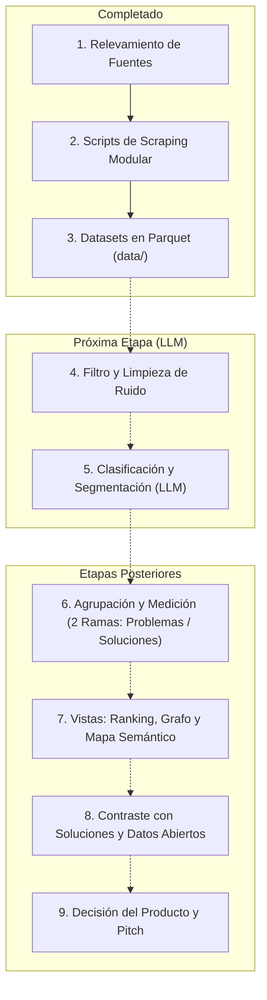

# Estado Actual del Proyecto: pipeline-decision-data

> **Fecha de corte:** Noviembre 2026  
> **Contexto:** Hack to the Future (Córdoba Tech Week 2026) · Global Gateway (UE) · ITC · Córdoba Cluster  
> **Equipo:** Ignacio, Lauti y Diego  

---

## 1. Visión y Propósito del Proyecto

El objetivo de este proyecto es **descubrir problemáticas recurrentes y desatendidas** en cuatro tracks de sostenibilidad mediante el procesamiento masivo de noticias y publicaciones especializadas:

1. **Gestión sostenible de residuos** (track inicial prioritario).
2. **Protección de la biodiversidad**.
3. **Movilidad sostenible**.
4. **Transición sostenible en el agro**.

Inspirado en el concepto de *Idea Plotter* (mapeo de espacios semánticos y detección de "zonas vacías"), el sistema busca procesar miles de notas periodísticas, consolidar la evidencia empírica (frecuencia, continuidad temporal, actores, alcance geográfico) y contrastar los problemas detectados contra soluciones tecnológicas ya existentes. Los datos orientan para que el equipo elija con solidez qué problema abordar y con qué fundamentación para el pitch de la hackathon.

---

## 2. Arquitectura General y Estado de las Etapas

El pipeline completo se estructura en 9 etapas clave. Actualmente están **completadas las etapas 1 a 3**:

---

## 3. Lo que ya fue Creado

### A. Scripts de Scraping y Procesamiento (`scripts/`)
Se desarrolló un ecosistema de scripts en Python orientado a descargas controladas, respetando `robots.txt`, con pausas configurables para evitar bloqueos y sin requerir navegadores pesados:

- **Medios generales y cordobeses:**
  - [`scripts/scrape_eldoce.py`](file:///b:/Facultad/EXTRAS/Hackatones/2026/pipeline-decision-data/scripts/scrape_eldoce.py): consume la API interna de búsqueda de El Doce (paginación de a 20 notas).
  - [`scripts/scrape_cba24n.py`](file:///b:/Facultad/EXTRAS/Hackatones/2026/pipeline-decision-data/scripts/scrape_cba24n.py): procesa sitemaps mensuales de CBA24N y extrae texto mediante JSON-LD y selectores HTML.
  - [`scripts/scrape_infobae.py`](file:///b:/Facultad/EXTRAS/Hackatones/2026/pipeline-decision-data/scripts/scrape_infobae.py): consulta feeds de tags y extrae contenido vía `Fusion.globalContent`.
  - [`scripts/scrape_ldjson.py`](file:///b:/Facultad/EXTRAS/Hackatones/2026/pipeline-decision-data/scripts/scrape_ldjson.py): extractor basado en JSON-LD para Clarín y La Nación (sitemaps históricos).
  - [`scripts/scrape_tn.py`](file:///b:/Facultad/EXTRAS/Hackatones/2026/pipeline-decision-data/scripts/scrape_tn.py) y [`scripts/scrape_cadena3.py`](file:///b:/Facultad/EXTRAS/Hackatones/2026/pipeline-decision-data/scripts/scrape_cadena3.py).
- **Medios especializados e internacionales:**
  - [`scripts/scrape_mongabay.py`](file:///b:/Facultad/EXTRAS/Hackatones/2026/pipeline-decision-data/scripts/scrape_mongabay.py): integración con la API REST de WordPress.
  - [`scripts/scrape_visionsustentable.py`](file:///b:/Facultad/EXTRAS/Hackatones/2026/pipeline-decision-data/scripts/scrape_visionsustentable.py), [`scripts/scrape_ecomundo.py`](file:///b:/Facultad/EXTRAS/Hackatones/2026/pipeline-decision-data/scripts/scrape_ecomundo.py), [`scripts/scrape_ecobiz.py`](file:///b:/Facultad/EXTRAS/Hackatones/2026/pipeline-decision-data/scripts/scrape_ecobiz.py), [`scripts/scrape_futurosustentable.py`](file:///b:/Facultad/EXTRAS/Hackatones/2026/pipeline-decision-data/scripts/scrape_futurosustentable.py).
  - [`scripts/scrape_internacional.py`](file:///b:/Facultad/EXTRAS/Hackatones/2026/pipeline-decision-data/scripts/scrape_internacional.py) y [`scripts/scrape_especializadas.py`](file:///b:/Facultad/EXTRAS/Hackatones/2026/pipeline-decision-data/scripts/scrape_especializadas.py): 19 portales internacionales (Grist, Resource Recycling, Circular Online, etc.).
- **Scraping de problemáticas en dos capas:**
  - [`scripts/scrape_problematicas.py`](file:///b:/Facultad/EXTRAS/Hackatones/2026/pipeline-decision-data/scripts/scrape_problematicas.py) y [`scripts/scrape_diarios_problematicas.py`](file:///b:/Facultad/EXTRAS/Hackatones/2026/pipeline-decision-data/scripts/scrape_diarios_problematicas.py): aplican la lógica de **tema + señales de problema y opinión** para clasificar el tipo de voz sin descartar datos a priori.
- **Utilidades del pipeline:**
  - [`scripts/separar_por_track.py`](file:///b:/Facultad/EXTRAS/Hackatones/2026/pipeline-decision-data/scripts/separar_por_track.py): clasifica notas hacia las 4 verticales temáticas.
  - [`scripts/soluciones.py`](file:///b:/Facultad/EXTRAS/Hackatones/2026/pipeline-decision-data/scripts/soluciones.py), [`scripts/dataset.py`](file:///b:/Facultad/EXTRAS/Hackatones/2026/pipeline-decision-data/scripts/dataset.py), [`scripts/html_texto.py`](file:///b:/Facultad/EXTRAS/Hackatones/2026/pipeline-decision-data/scripts/html_texto.py), [`scripts/progreso.py`](file:///b:/Facultad/EXTRAS/Hackatones/2026/pipeline-decision-data/scripts/progreso.py).

### B. Diccionarios de Búsqueda y Señales (`scripts/diccionarios/`)
- [`keywords_residuos.py`](file:///b:/Facultad/EXTRAS/Hackatones/2026/pipeline-decision-data/scripts/diccionarios/keywords_residuos.py): términos de búsqueda, raíces en múltiples idiomas (español, inglés, italiano, portugués, alemán, polaco) y expresiones regulares (`core keywords`).
- [`keywords_soluciones.py`](file:///b:/Facultad/EXTRAS/Hackatones/2026/pipeline-decision-data/scripts/diccionarios/keywords_soluciones.py): palabras clave sobre tecnologías, emprendimientos y productos sostenibles.
- [`keywords_biodiversidad.py`](file:///b:/Facultad/EXTRAS/Hackatones/2026/pipeline-decision-data/scripts/diccionarios/keywords_biodiversidad.py) y [`keywords_movilidad.py`](file:///b:/Facultad/EXTRAS/Hackatones/2026/pipeline-decision-data/scripts/diccionarios/keywords_movilidad.py): léxico específico por vertical.
- [`keywords_senales.py`](file:///b:/Facultad/EXTRAS/Hackatones/2026/pipeline-decision-data/scripts/diccionarios/keywords_senales.py): señales textuales para identificar problemas (*crisis, conflicto, reclamo, amenaza, déficit, etc.*) y voces especializadas (*investigador, CONICET, columna, ONG, biólogo, etc.*).

### C. Datasets Almacenados (`data/`)
Todos los datos recolectados se encuentran particionados en formato **Apache Parquet**:

| Carpeta | Contenido | Cantidad de Notas | Período Temporal | Fuentes |
|---|---|---:|---|---:|
| [`data/residuos/`](file:///b:/Facultad/EXTRAS/Hackatones/2026/pipeline-decision-data/data/residuos) | Notas relacionadas con gestión de residuos | 47.944 únicas | 2007 – 2026 | 33 |
| [`data/soluciones/`](file:///b:/Facultad/EXTRAS/Hackatones/2026/pipeline-decision-data/data/soluciones) | Notas sobre soluciones tecnológicas (subdivididas en `residuos/`, `agro/`, `movilidad/`, `biodiversidad/`) | 20.131 únicas | 2024 – 2026 | 62 |
| [`data/biodiversidad/`](file:///b:/Facultad/EXTRAS/Hackatones/2026/pipeline-decision-data/data/biodiversidad) | Problemáticas de biodiversidad con marcas de señales | 35.951 únicas | 2008 – 2026 | 13 |
| [`data/movilidad/`](file:///b:/Facultad/EXTRAS/Hackatones/2026/pipeline-decision-data/data/movilidad) | Problemáticas de transporte y movilidad (alto peso local de Córdoba) | 67.399 únicas | 2008 – 2026 | 10 |

#### Estructura y Esquema Común de los Datos
Cada fila de los archivos Parquet cuenta con:
- **Identificación:** `id`, `fuente`, `url`.
- **Contenido:** `titulo`, `bajada`, `body`, `fecha`.
- **Metadatos editoriales:** `seccion`, `tags`, `tipo`.
- **Metadatos léxicos / señales:** `terminos_busqueda`, `terminos_en_texto`, `diccionario_en_texto`, `keywords_core` y, en problemáticas, `vertical`, `tipo_voz`, `senal_problema` y `senal_opinion`.

### D. Documentación y Análisis Existente (`docs/`)
- **Análisis exhaustivo de datasets:** pros, contras, sesgos y métricas en [`analisis-dataset-residuos.md`](file:///b:/Facultad/EXTRAS/Hackatones/2026/pipeline-decision-data/docs/v1-residuos/analisis-dataset-residuos.md), [`analisis-dataset-soluciones.md`](file:///b:/Facultad/EXTRAS/Hackatones/2026/pipeline-decision-data/docs/analisis-datasets/analisis-dataset-soluciones.md), [`analisis-dataset-biodiversidad.md`](file:///b:/Facultad/EXTRAS/Hackatones/2026/pipeline-decision-data/docs/analisis-datasets/analisis-dataset-biodiversidad.md) y [`analisis-dataset-movilidad.md`](file:///b:/Facultad/EXTRAS/Hackatones/2026/pipeline-decision-data/docs/analisis-datasets/analisis-dataset-movilidad.md).
- **Contexto estratégico y reglas del evento:** [`contexto-pipeline.md`](file:///b:/Facultad/EXTRAS/Hackatones/2026/pipeline-decision-data/docs/analisis-datasets/contexto-pipeline.md) y [`CLAUDE.md`](file:///b:/Facultad/EXTRAS/Hackatones/2026/pipeline-decision-data/CLAUDE.md) (criterios de evaluación del jurado, reglas confirmadas de IA y datos externos).
- **Metodología de extracción y scraping:** [`scrapping-webs.md`](file:///b:/Facultad/EXTRAS/Hackatones/2026/pipeline-decision-data/docs/scrapping-webs.md) y [`circuito-problematicas.md`](file:///b:/Facultad/EXTRAS/Hackatones/2026/pipeline-decision-data/docs/circuito-problematicas.md).
- **Boceto de arquitectura interactiva:** [`pipeline-arquitectura.html`](file:///b:/Facultad/EXTRAS/Hackatones/2026/pipeline-decision-data/docs/pipeline-arquitectura.html).

---

## 4. Estado de Situación y Diagnóstico para la Tarea del LLM

Para la siguiente etapa (Etapas 4 y 5: filtro, limpieza, análisis y clasificación con LLM), el análisis previo arrojó los siguientes puntos críticos que el modelo deberá abordar:

1. **Ruido por polisemia y menciones superficiales:**
   - Hay notas que pasaron los filtros léxicos iniciales pero no son relevantes para sostenibilidad (ej. noticias políticas con "basura política", noticias de espectáculos, choques de tránsito sin relación con movilidad sostenible, etc.).
   - Gran disparidad entre notas con mención casual y notas cuyo núcleo temático es el problema ambiental.
2. **Duplicación y reescritura:**
   - Notas replicadas entre distintos diarios (cables de noticias o comunicados institucionales reescritos).
   - Notas que aparecen simultáneamente en el dataset de problemas y en el de soluciones.
3. **Calidad de contenido:**
   - Existen notas con cuerpos vacíos o muy cortos (galerías de fotos, videos de TN y El Doce).
4. **Objetivo de clasificación:**
   - Discernir fehacientemente si la nota describe:
     - Un **Problema** (causas, afectados, lugares, gravedad).
     - Una **Solución** (producto, startup, proyecto técnico, adopción real o mero anuncio).
     - **Ambas** (describe un problema y una propuesta de resolución).
     - **Irrelevante / Otra** (ruido a descartar).
