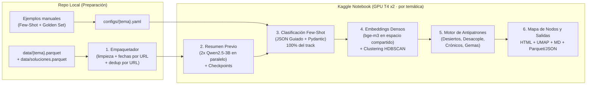

# Plan de Reestructuración desde Cero: Pipeline de Antipatrones en Kaggle

> **Propósito:** Plan conciso y compartible para reconstruir el pipeline de clasificación, detección de antipatrones y mapa de nodos **100% ejecutable en Kaggle (GPU T4 x2)**, comenzando con **Residuos** como piloto validado y dejando la arquitectura parametrizada para extrapolar directo a **Biodiversidad** y **Movilidad**.

---

## 1. Arquitectura Objetivo (End-to-End en Kaggle)

Cada temática tendrá su **propio Kaggle Dataset + Kaggle Notebook** alimentado por un archivo de configuración (`configs/{tema}.yaml`) que define taxonomía, raíces y ejemplos *few-shot*, compartiendo el mismo motor de código.



---

## 2. Reestructuración del Repositorio

Se propone limpiar la duplicación actual (`taxonomia.py` vs. `kaggle_pipeline.py` vs. `local_llamacpp_pipeline.py`) y organizar el código en 4 bloques claros:

```text
configs/
  residuos.yaml              # Taxonomía única, ejemplos few-shot y pesos del track
  biodiversidad.yaml         # Mismo esquema para extrapolar sin tocar código
  movilidad.yaml             # Mismo esquema para extrapolar sin tocar código
eval/
  golden_residuos.parquet    # Set de validación manual (basado en auditoría de 547 filas)
src/
  empaquetar.py              # Une data/{tema}.parquet + soluciones filtradas + recupera fechas
  llm_kaggle.py              # Pipeline T4 x2 (resumen + clasificación few-shot con JSON guiado)
  antipatrones.py            # Embeddings densos + HDBSCAN + 4 detectores + LLM Judge Top-30
  visualizar.py              # Grafo interactivo HTML (por clúster) + UMAP 2D + Reporte MD
notebooks/
  kaggle_residuos.ipynb      # Notebook específico del piloto Residuos
  kaggle_template.ipynb      # Plantilla parametrizada (TEMA = "biodiversidad" | "movilidad")
```

---

## 3. Fases de Ejecución (Piloto Residuos → Extrapolación)

### Fase 0 · Limpieza de Base y Empaquetado Único (Local)
- **Corregir el empaquetador** para leer directamente `data/residuos.parquet` (40.232 notas) **y sumar** las 6.811 notas de `data/soluciones.parquet` con `track == "residuos"` (deduplicando por `url`/`id`).
- **Recuperar fechas faltantes** desde patrones de URL (ej. `/2024/05/...`) para no perder continuidad temporal en medios de Córdoba.
- **Filtro duro de ruido obvio** (secciones de deportes/espectáculos/policiales, cuerpo < 150 chars) antes de subir el Parquet consolidado como **Kaggle Dataset privado** (`decision-data-residuos`).

### Fase 1 · Curación de Few-Shot y Golden Set (Local)
- Armar en `configs/residuos.yaml`:
  1. **Taxonomía única y cerrada** (10 `tipo_problema`, 8 `tipo_solucion`, 10 `TipoCausaRaiz`, 10 `subcategoria`, 4 `alcance_geografico`).
  2. **6 a 8 ejemplos manuales (*few-shot*)** bien elegidos cubriendo: `PROBLEMA` claro, `SOLUCION` clara, `AMBAS`, `POLITICA_O_ANUNCIO`, y 2 casos de `IRRELEVANTE` (ej. nota policial/consejo/falso positivo léxico).
- Guardar una muestra etiquetada a mano (de la auditoría previa) en `eval/golden_residuos.parquet` para medir precisión antes de correr el 100%.

### Fase 2 · Pipeline LLM en Kaggle T4 x2 (Resumen + Clasificación Estricta)
- **Motor:** `vLLM` (o `transformers` con generación guiada por esquema JSON / `outlines`) corriendo **2 instancias paralelas de `Qwen2.5-3B-Instruct` (1 por T4)** sobre particiones independientes del dataset.
- **Paso 2A — Resumen previo ultracorto:** condensar título + bajada + primeros 1.500 chars en 2–3 oraciones fácticas en español (qué pasó, dónde, quién, si es problema o solución). Acelera y estandariza la clasificación.
- **Paso 2B — Clasificación Few-Shot con Schema Estricto:**
  - Inyectar los ejemplos manuales de `configs/residuos.yaml`.
  - Forzar **Structured Output** (JSON guiado contra el schema Pydantic + `max_new_tokens=400`) para erradicar valores truncados (`ECO_D`), categorías inventadas y el bug de `metadatos` nulos.
  - Soportar explícitamente `tipo_nota` en `{PROBLEMA, SOLUCION, AMBAS, IRRELEVANTE}`.
- **Checkpoints reanudables:** guardar cada 500 notas en `/kaggle/working/` (y persistir como output dataset entre sesiones) para cubrir el 100% (~47k notas entre residuos + soluciones) sin perder progreso.

### Fase 3 · Validación Gate sobre Golden Set (Antes de Escalar)
- Correr Fase 2 sobre las ~547 notas auditadas y verificar umbrales mínimos antes de lanzar el 100%:
  - Falsos positivos en problemas: **< 10%** (vs. 51% actual).
  - Metadatos (`alcance_geo`, `subcategoria`, `ubicacion`) completos: **> 95%** (vs. 0% actual).
  - Soluciones con `tipo_problema_objetivo` válido: **> 90%** (vs. 22% actual).

### Fase 4 · Embeddings Densos, Clustering y Motor de Antipatrones (Kaggle)
1. **Embeddings semánticos densos** con `BAAI/bge-m3` (multilingüe, corre rápido en T4) en **espacio compartido de "dolor abordado"**:
   - Problema: `"{titulo}. {descripcion}. Material: {subcategoria}. Causas: {causas}"`
   - Solución: `"{detalle_problema_objetivo}. {descripcion_solucion}. Material: {subcategoria}"` (sin prefijos disjuntos `PROBLEMA:` / `SOLUCION:`).
2. **Unidad de análisis = Clúster de Problema (no nota individual):**
   - Deduplicar cables/reescrituras (similitud >= 0.90 dentro de +-7 días).
   - Agrupar problemas con **UMAP + HDBSCAN** (`min_cluster_size=3`). Los puntos sueltos (`cluster == -1`) se excluyen del ranking principal para que el ruido no contamine los huecos.
3. **4 Detectores Ortogonales de Antipatrones:**
   - **Desiertos de Solución (Gaps):** `GapScore = Demanda * (1 - Cobertura)`, donde `Demanda` combina volumen de hechos, medios independientes, continuidad temporal (años) y peso local (Córdoba/Argentina), y `Cobertura` mide la cobertura real de soluciones ponderada por madurez (`comercial > piloto > anuncio`).
   - **Desacople Oferta–Demanda:** matriz `(tipo_problema x material)` vs. soluciones para evidenciar sectores sobreatendidos vs. desatendidos.
   - **Problemas Crónicos:** clústeres persistentes (>= 3 años) con soluciones/planes fallidos previos.
   - **Gemas Ocultas:** soluciones válidas (pre-filtradas por madurez y afinidad real a un clúster de problema) con alta singularidad respecto al resto de soluciones.
4. **LLM-as-a-Judge sobre Top 30:** usar el mismo modelo en Kaggle para verificar si las 3 soluciones más cercanas a cada uno de los Top 30 desiertos realmente lo resuelven o son falsos matches.

### Fase 5 · Mapa de Nodos y Entregables Compartibles
Cada corrida de Kaggle genera un paquete autocontenido en `/kaggle/working/salidas/{tema}/`:
- **`grafo_antipatrones_{tema}.html`:** grafo interactivo (Vis.js) donde los nodos principales son **clústeres de problemas** (tamaño = demanda/recurrencia, borde destacado = Desierto sin solución) conectados a **clústeres/nodos de soluciones**, **causas raíz sistémicas** y **ubicaciones**.
- **`mapa_desiertos_{tema}.png`:** proyección UMAP 2D de demanda vs. oferta resaltando los Top 10 desiertos validados.
- **`reporte_antipatrones_{tema}.md`:** informe ejecutivo con rankings, evidencia (medios, años, casos locales) y lectura estratégica.
- **`clusters_y_gaps_{tema}.parquet` y `.json`:** tabla limpia con todas las métricas por clúster para auditoría o consumo posterior.

---

## 4. Cómo se Extrapola a Biodiversidad y Movilidad

Una vez validado el piloto de **Residuos** (Fases 0 a 5), replicarlo a otra temática requiere **solo 3 pasos sin modificar el motor**:
1. Crear `configs/{tema}.yaml` con la taxonomía del track y 6–8 ejemplos manuales *few-shot*.
2. Ejecutar `empaquetar.py --tema {tema}` (une `data/{tema}.parquet` + `data/soluciones.parquet` filtrado) y subirlo como Kaggle Dataset (`decision-data-{tema}`).
3. Clonar `kaggle_template.ipynb`, setear `TEMA = "biodiversidad"` (o `"movilidad"`) y ejecutar con checkpoints hasta completar el 100%.

---

## 5. Checklist de Hitos

| Hito | Criterio de Done |
|---|---|
| **H1 · Base limpia** | `empaquetar.py` genera el Parquet unificado (problemas + soluciones) con fechas recuperadas y 0 columnas rotas. |
| **H2 · Gate de calidad** | Clasificador few-shot + JSON guiado supera el Golden Set (<10% ruido, >95% metadatos completos). |
| **H3 · Piloto Residuos 100%** | 100% de Residuos + Soluciones procesados en Kaggle T4 x2 con checkpoints. |
| **H4 · Mapa y Reporte Residuos** | HTML interactivo por clúster, UMAP 2D, reporte MD y Parquet/JSON validados y compartidos con el equipo. |
| **H5 · Extrapolación** | Notebooks específicos de **Biodiversidad** y **Movilidad** configurados y listos para correr en Kaggle. |
